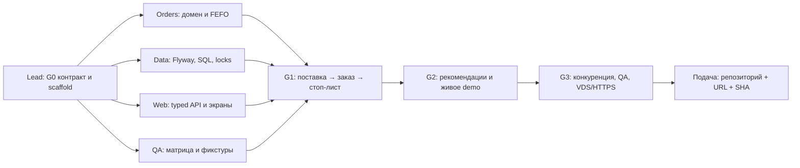

# FreshLine — рабочий штаб Quantum404

**Хакатон «Флагман» · 12–17 октября 2026**

FreshLine — веб-система для ресторанного склада: приёмка поставок по партиям, контроль сроков, атомарное списание заказа по FEFO, стоп-лист и объяснимые рекомендации. Отдельный демо-клиент создаёт синтетический поток поставок и заказов. [Требования презентации](docs/BRIEF_TRACEABILITY.md) · [границы MVP](specs/001-restaurant-inventory/spec.md).

> **Текущий факт:** опубликован план и контракт. Продукт, публичный URL и QA-приёмка ещё не готовы. Таблица ниже — снимок `main`; самый свежий статус находится в ветке соответствующей роли.

## Прогресс и передача — прямые ссылки

| Роль / ветка | Снимок на `main` | Следующий результат | Текущий статус | План части | Таблица задач | Журнал передачи |
|---|---|---|---|---|---|---|
| Lead · `codex/lead` | `FREE`, T001 | Java scaffold, контракт, Compose, CI | [lead](https://github.com/atomhuck/quantum404-freshline/blob/codex/lead/docs/progress/lead.md) | [план](docs/lanes/lead.md) | [20 пунктов](https://github.com/atomhuck/quantum404-freshline/blob/codex/lead/docs/tracking/lead.md) | [журнал](https://github.com/atomhuck/quantum404-freshline/blob/codex/lead/docs/handoffs/lead.md) |
| Backend orders · `codex/orders` | `FREE`, ждёт G0 | Домен, порты, FEFO | [orders](https://github.com/atomhuck/quantum404-freshline/blob/codex/orders/docs/progress/orders.md) | [план](docs/lanes/orders.md) | [8 пунктов](https://github.com/atomhuck/quantum404-freshline/blob/codex/lead/docs/tracking/orders.md) | [журнал](https://github.com/atomhuck/quantum404-freshline/blob/codex/orders/docs/handoffs/orders.md) |
| Backend fullstack · `codex/web` | `FREE`, T002 | UI shell и typed API | [web](https://github.com/atomhuck/quantum404-freshline/blob/codex/web/docs/progress/web.md) | [план](docs/lanes/web.md) | [12 пунктов](https://github.com/atomhuck/quantum404-freshline/blob/codex/lead/docs/tracking/web.md) | [журнал](https://github.com/atomhuck/quantum404-freshline/blob/codex/web/docs/handoffs/web.md) |
| Data engineer · `codex/data` | `FREE`, T003 после согласования модели | Миграция и SQL-порты | [data](https://github.com/atomhuck/quantum404-freshline/blob/codex/data/docs/progress/data.md) | [план](docs/lanes/data.md) | [13 пунктов](https://github.com/atomhuck/quantum404-freshline/blob/codex/lead/docs/tracking/data.md) | [журнал](https://github.com/atomhuck/quantum404-freshline/blob/codex/data/docs/handoffs/data.md) |
| QA · `codex/qa` | `FREE`, T004 | Матрица и фикстуры до кода | [qa](https://github.com/atomhuck/quantum404-freshline/blob/codex/qa/docs/progress/qa.md) | [план](docs/lanes/qa.md) | [10 пунктов](https://github.com/atomhuck/quantum404-freshline/blob/codex/lead/docs/tracking/qa.md) | [журнал](https://github.com/atomhuck/quantum404-freshline/blob/codex/qa/docs/handoffs/qa.md) |

**Как читать:** `FREE` — полоса свободна, задача не готова; `ACTIVE` — агент работает; `HANDOFF` — опубликована передача; `INTERRUPTED` — восстановление по [протоколу](docs/TEAM_WORKFLOW.md). Ссылки «статус» и «журнал» ведут **сразу в ветку роли**, где лежит самая свежая публикация. [Таблицы всех направлений](https://github.com/atomhuck/quantum404-freshline/blob/codex/lead/docs/tracking/README.md) пока опубликованы на `codex/lead`; их снимок обновляется по remote при интеграции. В статусе указаны владелец, задача, проверенный SHA, команды и `next_step`; журнал хранит хронологию передач. Lead обновляет снимок в этом README после интеграции; чекбокс [задачи](specs/001-restaurant-inventory/tasks.md) отмечается только после проверки и push.

| Ворота продукта | Статус на `main` | Что подтвердит готовность |
|---|---|---|
| G0 · контракт и каркас | `NOT RUN` | сборка, Flyway, контракт, CI/Compose |
| G1 · склад и атомарный заказ | `NOT RUN` | реальный PostgreSQL: партии → FEFO → стоп-лист |
| G2 · предложения и demo | `NOT RUN` | интегрированный браузерный путь и симулятор |
| G3 · публичный релиз | `NOT RUN` | HTTPS снаружи, QA verdict, P0=0, backup/restore |

`PASS` для ворот ставится только с точным SHA и ссылкой на evidence в progress/QA; частичный результат записывается как `WIP` или `FAIL`. До появления кода все строки честно `NOT RUN`.

## Кто начинает первым и как сходятся результаты

**Сразу и параллельно:** lead готовит Java scaffold/HTTP-контракт; fullstack делает UI shell по OpenAPI; QA пишет матрицу и фикстуры. Data engineer начинает Flyway-миграцию по утверждённой модели; Orders проектирует домен. После G0 Data и Orders фиксируют сигнатуры Java ports (T014) до зависимых repository/transaction реализаций. Никто не ждёт завершения чужого модуля целиком — только конкретного опубликованного контракта.

| Этап | Lead | Orders | Web | Data | QA | Критерий перехода |
|---|---|---|---|---|---|---|
| G0 · 12–13.10 | T001/005/006/009/010 | порты после freeze | T002/007/016 | T003/012 | T004/008 | опубликованы сборка, модель и контракт |
| G1 · 13–14.10 | delivery/stock/order API | expiry, demand, FEFO, гонки | приёмка, склад, заказ | receipt/order SQL, locks, ledger | реальные PG-кейсы | две партии → заказ → FEFO → стоп-лист |
| G2 · 15.10 | insights, SSE, Compose | risk/hot offers | dashboard, simulator, live UI | availability, replenishment, offers, seed | 5-минутный браузерный сценарий | сквозное demo на реальном API |
| G3 · 16.10 | security, VDS/HTTPS, release | исправление блокеров | mobile, accessibility | EXPLAIN, backup/restore | регрессия и внешний URL | P0=0, опубликован URL и точный SHA |

Зависимости по часам, порядок интеграции и действия при задержке: [общий план](docs/ROADMAP.md). Детальные результаты и проверки по ID: [tasks.md](specs/001-restaurant-inventory/tasks.md). Интеграция минимум дважды в день. Три backend-разработчика — lead, orders и fullstack; дата-инженер работает внутри общего Java/SQL приложения, QA начинает до появления кода.

## Инструкция участнику на другом компьютере

1. Клонировать `https://github.com/atomhuck/quantum404-freshline.git` в локальную папку вне OneDrive, открыть её агенту и выбрать ветку своей роли. Два ноутбука одной роли используют **одну удалённую ветку**, но только один активный владелец за раз.
2. Скопировать раздел **«Старт»** из [своего промпта](prompts/README.md). Агент читает `AGENTS.md`, план роли, статус, журнал, `tasks.md`, remote commits; делает claim и берёт ближайшую доступную задачу. Человеку не нужно читать или менять код.
3. После малого проверяемого результата агент выполняет тест, делает code commit, записывает SHA/результат/следующий шаг в status и push. Непроверенное остаётся `NOT RUN`.
4. Для плановой смены ноутбука первый агент использует промпт **«Передача»**, ставит `HANDOFF` и добавляет запись в журнал; второй использует **«Продолжение»**, сверяет remote HEAD и начинает с `next_step`. При внезапном обрыве — [процедура takeover](docs/TEAM_WORKFLOW.md#внезапное-прерывание-и-takeover).
5. Lead сливает проверенные изменения, обновляет снимок прогресса и gate в README; QA независимо фиксирует PASS/FAIL/NOT RUN на конкретном SHA и URL. Секреты в Git не попадают.

**Промпты:** [lead](prompts/backend-lead.md) · [orders](prompts/backend-orders.md) · [fullstack/web](prompts/backend-fullstack.md) · [data](prompts/data-engineer.md) · [QA](prompts/qa.md). **Если нужен человек:** [H-01…H-08](docs/HUMAN_REQUIRED.md).

## Что увидит жюри в целевом MVP

1. Поставка с несколькими партиями и сроками; пригодный и общий остаток, риск списания.
2. Заказ нескольких блюд принимается целиком или отклоняется с объяснением дефицита; FEFO и идемпотентность проверены при конкуренции.
3. Стоп-лист реагирует на заказ, поставку и истечение срока; рекомендации объясняют, что докупить и что можно предложить сейчас.
4. Синтетический демо-клиент показывает поток событий. Его остановка не выключает ручной продукт.
5. QA предъявляет результаты на реальном PostgreSQL и публичном HTTPS-адресе, включая повторы, гонки и восстановление.

## Стек, контракт и справочник

Java 21 · Spring Boot 3.5.16 · PostgreSQL 17 · Flyway · jOOQ/JDBC · React 19 / TypeScript / Vite · Chakra UI 3 · TanStack Query · Docker Compose · Caddy HTTPS. Один модульный Java API; Python только в контейнере синтетического симулятора. [Технический план](specs/001-restaurant-inventory/plan.md) · [OpenAPI](contracts/openapi.yaml) · [правила домена](docs/DOMAIN_RULES.md) · [архитектурные решения](docs/DECISIONS.md).

[Архитектура](docs/diagrams/architecture.md) · [ER-модель](docs/diagrams/erd.md) · [CJM](docs/diagrams/cjm.md) · [UX/UI](docs/FRONTEND.md) · [QA](docs/QA.md) · [деплой](docs/DEPLOYMENT.md) · [вопросы эксперту](docs/EXPERT_SESSION.md). Звёздочные улучшения перечислены отдельно в [календаре](docs/ROADMAP.md), MVP от них не зависит.

После появления кода ожидаемый локальный старт — `docker compose --profile demo up -d --build --wait`; до реализации эта команда **не заявляется работающей**.

## Подача решения

К сдаче здесь появятся проверенный HTTPS URL, точный commit/tag, доступ в demo, 5-минутный маршрут и фактический verdict QA. Сейчас URL продукта нет. Покупать домен для MVP не обязательно; нужен стабильный HTTPS-hostname. Минимальные действия человека перечислены в [H-01…H-08](docs/HUMAN_REQUIRED.md): GitHub-доступы участников, параметры имеющегося VDS, точное время подачи и финальная проверка ссылки. Исходный PDF и экспорты чатов в репозиторий не публикуются.
