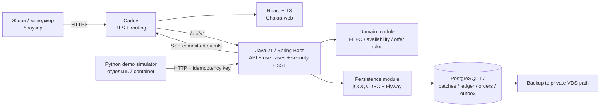

# Архитектура

Одна транзакционная граница находится внутри Java API и PostgreSQL. Демо-клиент не имеет DB credentials. Браузер не рассчитывает окончательную доступность. Наружу открыты только 80/443; PostgreSQL живёт в приватной сети Compose. В production simulator отключён, demo seed и код доступа запрещены.
