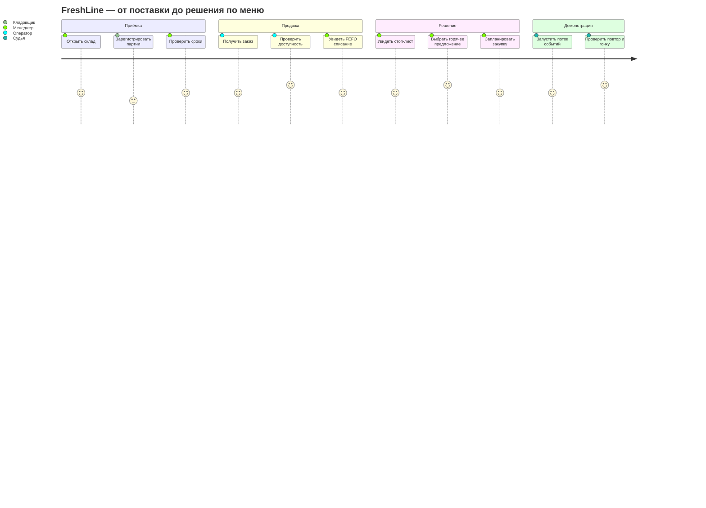

# CJM: путь менеджера ресторана и судьи

Оценки удобства ниже — гипотеза для проектирования, не измеренное исследование.

| Этап | Боль | Ответ интерфейса | Приёмка |
|---|---|---|---|
| Приёмка | У одного продукта несколько сроков, цифры легко смешать | Две партионные строки, суммарный и пригодный остаток отдельно | FR-001…003 |
| Заказ | Ингредиента может хватить на одно блюдо, но не на весь заказ | Все блюда проверяются вместе, дефицит показан до подтверждения; сервер решает при фиксации | FR-004…007 |
| Срок | Просрочка и близкий срок остаются незамеченными | Цвет + текст + число дней; FEFO-партия выделена | FR-006,009 |
| Стоп-лист | Непонятно, почему блюдо исчезло | Карточка показывает именно недостающий ингредиент/количество | FR-008 |
| Горячее предложение | Непонятно, почему предложено блюдо | 1–3 причины с датой и количеством; недоступных блюд нет | FR-011 |
| Рестарт/сбой | Опасение повторной продажи/списания | Исход операции восстанавливается по ключу и истории | FR-007,015,017 |

Основная дорожка судьи: новая поставка → два разных срока одного продукта → заказ из двух блюд → обновление склада и stop-list → hot offer → повтор заказа → конкурентный сценарий QA. На 5-минутной демонстрации не показывать выдуманные метрики или недоступную кнопку.
