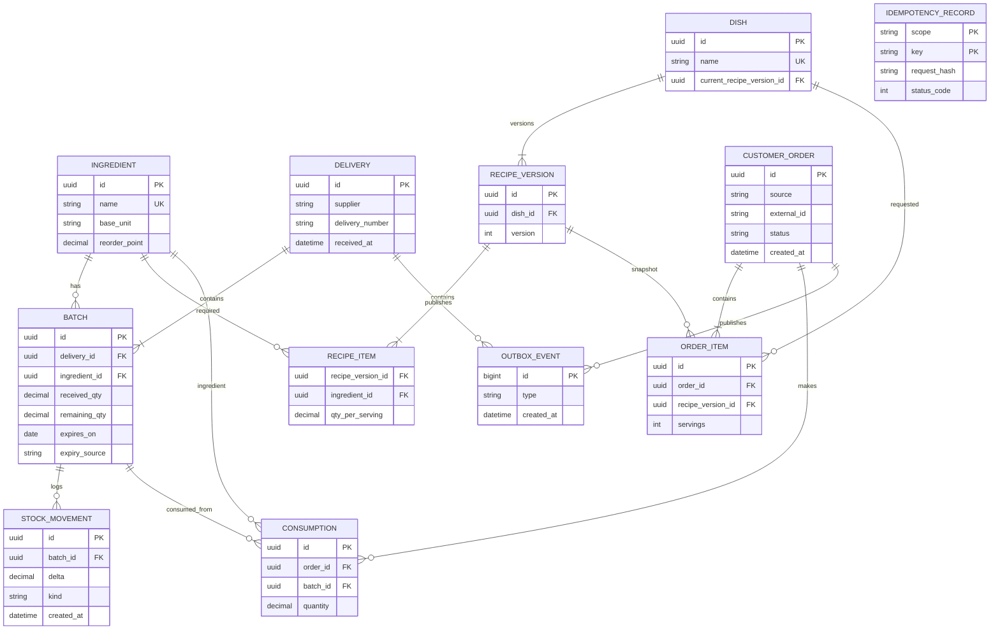

# ER-модель склада

`IDEMPOTENCY_RECORD` относится к команде по `(scope,key)` и намеренно не связан с заказом FK: один механизм обслуживает заказ и поставку. Это не отступление от модели. Поля и ограничения для миграции: [data-model](../../specs/001-restaurant-inventory/data-model.md).
